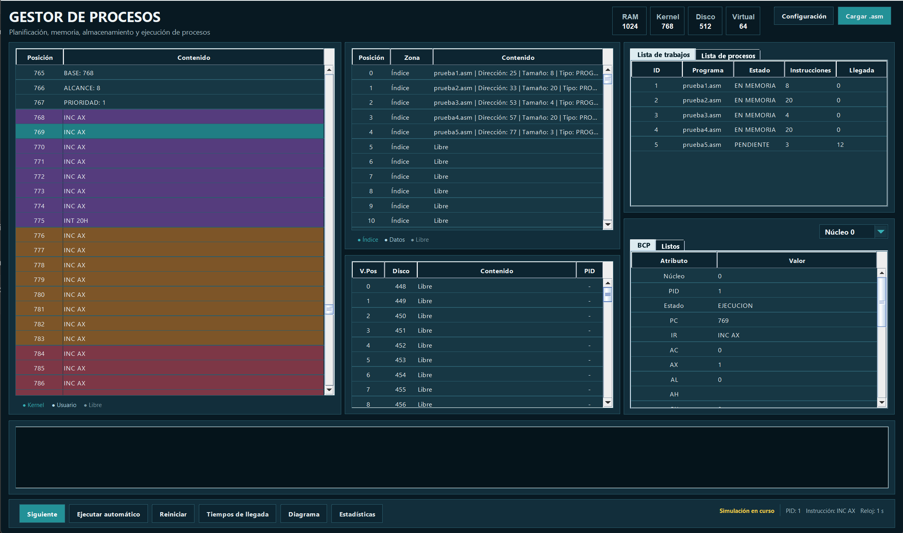

# Proyecto 2: Gestor de Procesos y Memoria

Proyecto del curso **Principios de Sistemas Operativos**, desarrollado en Netbeans.

El simulador permite observar la ejecución de programas ASM, la planificación de CPU, los cambios de contexto y la asignación de memoria. Cada instrucción representa un segundo de ejecución y una posición de memoria.



## Integrantes

| Integrante | Nombre completo |
|---|---|
| 1 | Erin Camacho González |
| 2 | David Calvo García |

## Objetivos alcanzados

- Cargar varios archivos ASM y validar sus instrucciones.
- Configurar entre **1 y 5 núcleos**, con un máximo de **5 procesos por núcleo** y **25 procesos en total**, sujeto al espacio de memoria disponible.
- Configurar los tiempos de llegada y los parámetros de planificación antes de ejecutar.
- Asignar los procesos automáticamente al núcleo con menos procesos; en caso de empate, elegir el de menor identificador.
- Ejecutar manualmente, segundo a segundo, o de forma automática.
- Guardar y restaurar el contexto de los procesos mediante el BCP.
- Configurar el tamaño de la RAM y del almacenamiento secundario.
- Asignar y liberar memoria utilizando las estrategias implementadas.
- Mantener procesos en memoria virtual cuando no pueden ingresar a RAM y promoverlos cuando se libera espacio.
- Visualizar RAM, disco, memoria virtual, trabajos, procesos, BCP y cola de listos del núcleo seleccionado.
- Consultar el diagrama de Gantt durante y después de la ejecución.
- Mostrar estadísticas por ejecución y resultados acumulados durante la sesión.

### Algoritmos de planificación

| Algoritmo | Configuración disponible |
|---|---|
| FCFS | Sin parámetros adicionales |
| SPN | Sin parámetros adicionales |
| HRRN | Sin parámetros adicionales |
| Round Robin | Quantum |
| SRT | Sin parámetros adicionales |
| Por prioridad | Prioridad por proceso y modo apropiativo o no apropiativo |
| Selfish Round Robin | Quantum y tasas `a` y `b` |
| Lottery | Quantum y tickets por proceso |
| Guaranteed Scheduling | Quantum |
| Multilevel Feedback Queue | Quantum base; tres niveles con turnos de una, dos y cuatro veces ese valor |

### Estrategias de memoria

- Particiones fijas de tamaños iguales.
- Particiones fijas de tamaños diferentes.
- Particiones dinámicas con First Fit, Next Fit y Best Fit.
- Paginación en RAM.

La memoria virtual utiliza actualmente bloques contiguos dentro del almacenamiento secundario.

## Requisitos

- **JDK 22** o una versión posterior que permita compilar para Java 22.
- **Apache NetBeans** para abrir y ejecutar el proyecto desde el IDE.

La aplicación utiliza las bibliotecas estándar de Java y Swing; no requiere bibliotecas externas de ejecución.

## Ejecución

### Desde NetBeans

1. Seleccionar **Archivo > Abrir proyecto**.
2. Abrir la carpeta `MiniPC`, que contiene el archivo `pom.xml`.
3. Configurar el proyecto para utilizar JDK 22 o superior.
4. Ejecutar el proyecto. Clic derecho en la clase `VentanaPrincipal` y seleccionar Run Java.


## Uso del simulador

1. Abrir **Configuración** y seleccionar núcleos, algoritmo, parámetros, tamaños de memoria y estrategia de asignación.
2. Presionar **Cargar .asm** y seleccionar los programas.
3. Abrir **Tiempos de llegada**, ingresar los valores y confirmarlos. Según el algoritmo, también se pueden editar prioridades o tickets.
4. Presionar **Siguiente** para avanzar un segundo global, o **Ejecutar automático** para avanzar cada segundo.
5. Elegir un núcleo en el selector para consultar su BCP y sus procesos listos.
6. Abrir **Diagrama** para observar las celdas de ejecución por proceso y segundo, agrupadas por núcleo.
7. Al finalizar, abrir **Estadísticas** para consultar los resultados actuales y acumulados.
8. Usar **Reiniciar** para preparar otra simulación. Los resultados acumulados se conservan mientras la aplicación siga abierta.

Todos los núcleos comparten el mismo reloj, que comienza en cero. Un proceso conserva el núcleo asignado durante su ejecución. Para cambiar la configuración o cargar nuevos programas después de iniciar, se debe reiniciar la simulación.

## Programas ASM

Los archivos deben tener extensión `.asm`, con una instrucción por línea. Se admiten operaciones de movimiento, aritmética, comparación, saltos, pila e interrupciones.

Ejemplo que suma dos valores y muestra el resultado en la consola:

```asm
MOV AX, 5
MOV BX, 3
LOAD AX
ADD BX
STORE DX
INT 10H
INT 20H
```

Las interrupciones disponibles son `INT 10H`, `INT 20H` e `INT 21H`.

## Estadísticas

Se muestran el algoritmo, tiempo de inicio, tiempo final, tiempo ocioso, estancia y relación `Tr/Ts`.

- **Tr:** tiempo de estancia, calculado como finalización menos llegada.
- **Ts:** segundos de CPU recibidos por el proceso.
- **Tr/Ts:** relación entre estancia y servicio.

Los promedios consideran los procesos finalizados normalmente. En varios núcleos, el tiempo ocioso total es la suma de los tiempos ociosos de cada núcleo. La pestaña **Acumuladas** conserva las ejecuciones terminadas y permite consultar sus procesos.

## Organización del código

```text
MiniPC/
├── pom.xml
└── src/main/java/
    ├── com/minipc/minipc/       # Clase principal
    ├── controlador/            # Eventos y actualización de la interfaz
    ├── modelo/                 # CPU, procesos, BCP, memoria y resultados
    ├── auxiliares/             # Simulador, núcleos, carga y administración
    │   ├── algoritmosPlanificacion/
    │   └── estrategiasMemoria/
    └── vista/                  # Ventana principal y diálogos
```

## Valoración del proyecto

**Valoración del estado del proyecto: [5]**


## Video de demostración

**Enlace al video en YouTube:**

